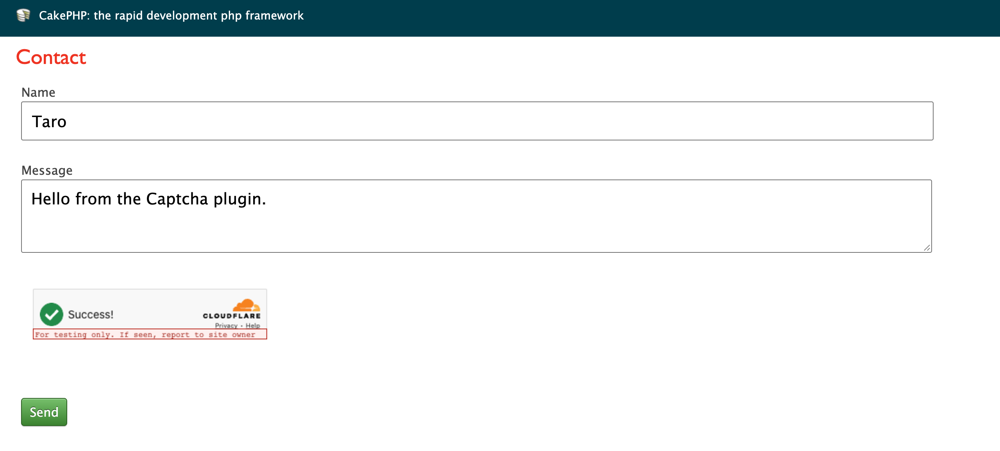

# CakePHP 2 Captcha Plugin

[](LICENSE)
[](https://packagist.org/packages/pieceofcake2/captcha)

[](https://github.com/pieceofcake2/captcha/actions/workflows/CI.yml)

[](https://github.com/pieceofcake2/captcha/actions/workflows/CI.yml)
[](https://codecov.io/gh/pieceofcake2/captcha)

CAPTCHA support for [pieceofcake2/cakephp](https://github.com/pieceofcake2/cakephp) applications.
A helper renders the widget and a component verifies the token on the server.

| Provider | `provider` |
| --- | --- |
| [Cloudflare Turnstile](https://developers.cloudflare.com/turnstile/) | `turnstile` (default) |
| [Google reCAPTCHA v2](https://developers.google.com/recaptcha/docs/display) (checkbox) | `recaptcha_v2` |
| [Google reCAPTCHA v3](https://developers.google.com/recaptcha/docs/v3) (score) | `recaptcha_v3` |
| [hCaptcha](https://docs.hcaptcha.com/) | `hcaptcha` |



## Requirements

* PHP 8.0+
* pieceofcake2/cakephp 2.12+

## Installation

```
composer require pieceofcake2/captcha
```

Load the plugin in `config/bootstrap.php` (legacy layout: `app/Config/bootstrap.php`) and configure
the provider. Keep the keys out of the repository, e.g. in `config/.env`:

```php
CakePlugin::load('Captcha');

Configure::write('Captcha', [
    'provider' => 'turnstile',
    'siteKey' => env('CAPTCHA_SITE_KEY'),
    'secretKey' => env('CAPTCHA_SECRET_KEY'),
]);
```

See [Installation](docs/README.md#installation) for the `installer-paths` setting.

## Usage

```php
class ContactsController extends AppController
{
    public $components = ['Captcha.Captcha' => ['actions' => ['add']]];

    public $helpers = ['Captcha.Captcha'];
}
```

```php
// templates/Contacts/add.ctp
echo $this->Form->create('Contact');
echo $this->Form->input('message');
echo $this->Captcha->widget();
echo $this->Form->end('Send');
```

POST requests to `add` are verified before the action runs. When the verification fails, the
component sets a flash message and redirects back. You can also verify manually with
`$this->Captcha->verify()`.

## Documentation

Documentation: https://pieceofcake2.github.io/captcha/

It covers the configuration, the helper and component API,
reCAPTCHA v3, CSP nonces, test keys and security notes.

## Reporting Issues

Please open an issue on [GitHub](https://github.com/pieceofcake2/captcha/issues).
To report a security vulnerability, use [private vulnerability reporting](https://github.com/pieceofcake2/captcha/security/advisories/new).

## Contributing

See the [contribution guidelines](https://github.com/pieceofcake2/.github/blob/master/CONTRIBUTING.md).

## License

The MIT License. See [LICENSE](LICENSE).
